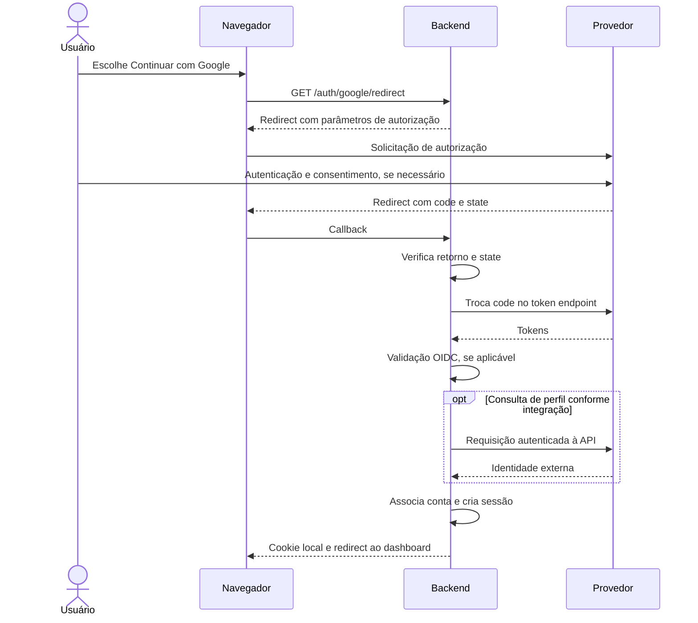

# Login Social — apresentação acadêmica

**Autor:** Hyan Ferreira  
**Disciplina:** Programação para Dispositivos Móveis  
**Tema:** Login Social, OAuth 2.0, OpenID Connect e integração com Laravel Socialite.

## Resumo

Login Social é uma forma de entrar em uma aplicação utilizando uma identidade mantida por um provedor externo, como Google, GitHub ou Apple. Em vez de exigir que a pessoa crie mais uma senha, a aplicação delega a autenticação externa ao provedor, verifica o retorno, identifica ou cria a conta local e estabelece sua própria sessão. O objetivo é reduzir o atrito de entrada sem abandonar a responsabilidade pela segurança e pela autorização.

A apresentação explica a diferença entre autenticação e autorização, os protocolos OAuth 2.0 e OpenID Connect (OIDC), os participantes e as dez etapas de um fluxo de autorização por código, os tokens envolvidos, a configuração dos provedores e as boas práticas de segurança. O exemplo utiliza Laravel Socialite em um backend de referência e um botão React para ilustrar a integração. Os conceitos se aplicam a aplicações web e móveis, respeitando as diferenças entre clientes públicos e confidenciais.

Este README é um material de estudo independente: não é necessário executar a apresentação para compreender a matéria. A aplicação web contém 17 slides e uma demonstração interativa exclusivamente simulada; não realiza login real.

**Palavras-chave:** login social, autenticação, autorização delegada, OAuth 2.0, OpenID Connect, tokens, PKCE, Laravel Socialite, identidade federada, sessão.

## Sumário

- [Questões propostas pelo professor](#questões-propostas-pelo-professor)
- [Conteúdo acadêmico da apresentação](#conteúdo-acadêmico-da-apresentação)
  - [Fundamentos de autenticação e autorização](#fundamentos-de-autenticação-e-autorização)
  - [OAuth 2.0 e OpenID Connect](#oauth-20-e-openid-connect)
  - [Arquitetura e fluxo de login](#arquitetura-e-fluxo-de-login)
  - [Configuração, códigos, tokens e sessões](#configuração-códigos-tokens-e-sessões)
  - [Implementação com Laravel Socialite](#implementação-com-laravel-socialite)
  - [Associação de contas](#associação-de-contas)
  - [Comparação entre provedores](#comparação-entre-provedores)
  - [Segurança e aplicações móveis](#segurança-e-aplicações-móveis)
  - [Demonstração e conclusão](#demonstração-e-conclusão)
- [Glossário](#glossário)
- [Perguntas e respostas para revisão](#perguntas-e-respostas-para-revisão)
- [Sobre a aplicação web](#sobre-a-aplicação-web)
- [Executar](#executar)
- [Controles](#controles)
- [Preparar para a aula](#preparar-para-a-aula)
- [Arquitetura](#arquitetura)
- [Verificações](#verificações)
- [Referências](#referências)

## Questões propostas pelo professor

### Que problema ela resolve?

O Login Social reduz a necessidade de criar e memorizar credenciais diferentes para cada serviço. No cadastro convencional, a pessoa precisa preencher dados, escolher uma senha e, frequentemente, confirmar o e-mail. A aplicação, por sua vez, precisa armazenar hashes de senhas, implementar recuperação de acesso e proteger a autenticação contra ataques.

Com Login Social, parte dessa responsabilidade é delegada a um provedor no qual o usuário já possui uma conta. A pessoa pode aproveitar a autenticação existente no provedor e, quando necessário, autorizar o compartilhamento de informações. Isso pode diminuir a desistência no cadastro e a exposição associada à reutilização de senhas, além de permitir aproveitar mecanismos de segurança do provedor, como autenticação multifator.

A aplicação continua responsável por validar o retorno, gerenciar sua conta local, proteger a sessão e verificar permissões. A delegação não elimina ataques nem torna uma implementação automaticamente segura.

### Quais os principais recursos?

- Autenticação mediante uma conta externa já existente.
- Autorização delegada mediante OAuth 2.0 e identificação padronizada mediante OpenID Connect, quando suportado.
- Redirecionamento ao provedor, seleção de conta e consentimento conforme os escopos solicitados.
- Troca de um código de autorização temporário por tokens, que podem permitir acesso a APIs ou comunicar a identidade autenticada.
- Obtenção de dados de perfil autorizados, como identificador, nome, e-mail e foto, conforme disponibilidade.
- Associação entre a identidade externa e uma conta interna, seguida da criação de uma sessão local.
- Proteções como state, PKCE e, quando aplicável, nonce e validação de ID Token.

Esses são recursos da tecnologia. Os diagramas progressivos, as notas e o modo offline são recursos da apresentação web, e não características necessárias de um sistema de Login Social.

### Tem alguma limitação?

Sim. Um novo login normalmente depende da conectividade e da disponibilidade do provedor. Bloqueio, perda de acesso ou exclusão da conta externa podem impedir novas autenticações caso não exista uma alternativa de recuperação. Uma sessão local já estabelecida pode continuar válida, dependendo da política da aplicação.

Cada provedor possui APIs, escopos, requisitos de configuração e regras de consentimento próprios. Informações como e-mail e foto podem não ser fornecidas; solicitar dados excessivos compromete a privacidade. A integração também exige manutenção quando o provedor altera suas políticas.

Há riscos de associação incorreta entre contas, roubo de tokens, callbacks mal validados e exposição de segredos. A aplicação precisa implementar autorização, recuperação de acesso, proteção de sessões e tratamento de falhas. O Login Social autentica uma conta externa, não comprova automaticamente a identidade civil da pessoa.

O modo offline dos slides funciona porque a demonstração é simulada. Ele não significa que um Login Social real pode consultar o Google sem conectividade.

### Quais as principais diferenças entre recursos similares?

| Abordagem | Como funciona | Principal vantagem | Limitação importante |
| --- | --- | --- | --- |
| Login tradicional | A aplicação verifica suas próprias credenciais, geralmente e-mail e senha. | Independência de um provedor de identidade externo. | Gestão de senhas, recuperação e proteção contra ataques ficam a cargo da aplicação. |
| Login Social | Um provedor externo autentica a conta; a aplicação verifica a identidade e cria uma sessão. | Menos cadastros e senhas adicionais. | Dependência do provedor e necessidade de integração segura. |
| Magic Link | Um link temporário e de uso controlado é enviado ao e-mail do usuário. | Não exige memorizar senha. | Depende do acesso à caixa de e-mail e da segurança do link. |
| Passkeys | Credenciais criptográficas de chave pública, normalmente desbloqueadas por biometria ou PIN do dispositivo. | Resistência a phishing e ausência de senha compartilhada. | Exige suporte dos dispositivos e estratégia de recuperação. |
| Single Sign-On (SSO) | Uma autenticação em um domínio de confiança permite acessar vários serviços integrados. | Reduz autenticações repetidas entre sistemas. | Exige integração e gestão de confiança entre os serviços. |

Magic Link, passkeys e SSO são comparações complementares aos slides. Essas abordagens não são mutuamente exclusivas: um provedor de Login Social pode utilizar passkeys, e uma solução de identidade federada pode oferecer SSO. SSO descreve uma experiência de acesso a múltiplos sistemas, e não um protocolo único.

OAuth 2.0 e OIDC também não são sinônimos: o primeiro define autorização delegada; o segundo acrescenta uma camada de autenticação. Provedores com botões visualmente semelhantes podem utilizar protocolos e APIs diferentes, como detalhado na [comparação entre provedores](#comparação-entre-provedores).

## Conteúdo acadêmico da apresentação

### Fundamentos de autenticação e autorização

**Autenticação** responde à pergunta “Quem é você?”. É o processo de verificar uma identidade ou o controle de uma conta. **Autorização** responde à pergunta “O que você pode fazer?”. Define quais recursos e operações aquela identidade pode acessar.

Imagine a portaria de uma faculdade: apresentar um documento permite identificar uma pessoa, mas não concede acesso a todas as salas. Analogamente, um estudante autenticado em um sistema acadêmico não deve poder entrar na área administrativa apenas por estar logado.

No Laravel, por exemplo:

```php
// Há um usuário autenticado no guard atual?
auth()->check();

// O usuário possui a habilidade configurada?
$user->can('access-admin');
```

O segundo exemplo pressupõe uma habilidade definida por Gate ou Policy. Ocultar um botão no frontend ajuda a interface, mas não protege a operação: a autorização precisa ser aplicada no backend, inclusive nas rotas e APIs.

### OAuth 2.0 e OpenID Connect

**OAuth 2.0** é um framework de autorização delegada. Permite que um cliente obtenha acesso limitado a recursos protegidos sem conhecer a senha que o usuário utiliza no provedor. Por exemplo, uma aplicação pode solicitar acesso a uma agenda do Google para exibir compromissos. O acesso concedido é representado por um Access Token, sujeito a escopos, validade e outras restrições.

OAuth 2.0 isoladamente não define um protocolo interoperável de autenticação de usuários. **OpenID Connect (OIDC)** acrescenta essa camada de identidade sobre OAuth 2.0. Uma solicitação OIDC inclui o escopo `openid` e, no fluxo aplicável, produz um ID Token com informações verificáveis sobre a autenticação.

Um provedor OAuth também pode oferecer uma API autenticada de perfil. O GitHub OAuth Apps é um exemplo dessa integração: o cliente usa um Access Token para consultar a identidade na API. Isso não transforma a integração em OIDC.

As informações contidas em um token são chamadas **claims**. Em OIDC, algumas claims fundamentais são:

| Claim | Significado |
| --- | --- |
| `iss` | Emissor do token. |
| `sub` | Identificador do sujeito no contexto do emissor. |
| `aud` | Destinatário ou audiência para a qual o token foi emitido. |
| `exp` | Instante de expiração. |
| `nonce` | Valor de correlação com a solicitação OIDC, quando utilizado. |

A identidade OIDC deve ser associada ao par emissor e subject (`iss` + `sub`), não simplesmente ao e-mail. Um e-mail é um atributo que pode mudar e pode estar ausente.

### Arquitetura e fluxo de login

#### Participantes

| Participante | Responsabilidade |
| --- | --- |
| Usuário | Escolhe o provedor, autentica sua conta e consente quando necessário. |
| Navegador/frontend | Exibe as interfaces, inicia a navegação e segue os redirecionamentos. |
| Backend da aplicação | Configura o cliente, verifica o retorno, troca o código, associa a identidade e cria a sessão local. |
| Provedor externo | Autentica a conta externa e disponibiliza os artefatos e recursos previstos pelo protocolo. |

No modelo OAuth, o servidor de autorização (Authorization Server) emite tokens, e o servidor de recursos (Resource Server) disponibiliza APIs protegidas. O diagrama da aula agrupa esses papéis no provedor para facilitar a visualização.

O navegador é um ambiente público e não deve armazenar segredos de um cliente confidencial. Um redirect HTTP instrui o navegador a navegar para outro endereço; não é a mesma coisa que o backend fazer uma requisição direta ao provedor.

#### As dez etapas do Authorization Code Flow

O exemplo abaixo acompanha o fluxo do slide 7, utilizando o Google e um backend web confidencial.

1. **Clique:** a pessoa seleciona “Continuar com Google”. O navegador abre uma rota de autenticação da própria aplicação.
2. **Redirecionamento:** o backend monta a solicitação de autorização, incluindo Client ID, Redirect URI, escopos, tipo de resposta e proteções do fluxo. Responde com um redirect HTTP; o navegador segue para o provedor.
3. **Autenticação externa:** o Google identifica a conta, podendo exigir senha, passkey, segundo fator ou reutilizar uma sessão existente. A aplicação não recebe a senha do Google.
4. **Consentimento:** o provedor solicita autorização para os escopos quando necessário. Autorizações anteriores podem dispensar uma nova tela; se a pessoa recusar, o fluxo deve ser interrompido de forma segura.
5. **Callback:** o provedor redireciona o navegador à URI cadastrada, retornando um código temporário e state no caso de sucesso do fluxo ilustrado.
6. **Verificação do retorno:** o backend trata erros e confere se a resposta corresponde à tentativa iniciada. Não aceita uma identidade apenas porque ela apareceu como parâmetro da URL.
7. **Troca do código:** o backend envia o código ao endpoint de tokens do provedor, utilizando a autenticação do cliente confidencial e o code verifier quando PKCE está habilitado. O código é de uso único e não é uma sessão.
8. **Identidade:** a aplicação obtém a identidade confiável de acordo com a integração: valida o ID Token em OIDC ou consulta a API autenticada de perfil, como no adaptador Google do Socialite demonstrado.
9. **Conta local:** o backend procura a associação pelo provedor e identificador externo. Se necessário, segue uma política explícita para criar uma nova conta ou realizar uma vinculação segura.
10. **Sessão local:** a aplicação autentica o usuário internamente, regenera o identificador da sessão e envia seu próprio cookie de sessão ao navegador. O dashboard passa a utilizar a identidade e as permissões locais.



O diagrama é uma representação didática; a sequência textual descreve o mesmo conteúdo sem depender da renderização Mermaid. Observe que o código passa pelo navegador, mas a troca por tokens neste exemplo é servidor-servidor.

### Configuração, códigos, tokens e sessões

#### Configuração de um cliente

| Elemento | Finalidade |
| --- | --- |
| Client ID | Identificador público do cliente registrado no provedor. |
| Client Secret | Credencial de um cliente confidencial, mantida exclusivamente no servidor. |
| Redirect URI | Endereço autorizado para receber o retorno da tentativa. |
| Scope | Escopo de acesso ou de informações solicitado, como `openid`, `profile` e `email` em OIDC. |
| Consentimento | Autorização concedida pela pessoa, de acordo com os escopos e regras do provedor. |

O registro de uma aplicação web no Google envolve criar um projeto, configurar o público e a apresentação do consentimento, registrar um cliente OAuth Web e cadastrar a URI de retorno. No exemplo local, usa-se `http://localhost:8000/auth/google/callback`. Em produção, utilize HTTPS e a URI efetivamente cadastrada. O público e os escopos podem exigir usuários de teste ou verificação adicional.

O Client ID não é segredo. O Client Secret não é a senha do usuário e jamais deve estar em uma URL, no bundle JavaScript ou em variáveis públicas como `VITE_GOOGLE_CLIENT_SECRET`. Variáveis com prefixo `VITE_` podem ser incorporadas ao código entregue ao navegador.

#### Artefatos do fluxo

| Artefato | Para que serve | Características |
| --- | --- | --- |
| Authorization Code | Ser trocado por tokens no endpoint de tokens. | Temporário e de uso único; não autentica diretamente a sessão local. |
| Access Token | Autorizar o acesso a APIs ou recursos protegidos. | Possui validade e restrições de acesso; pode ser opaco ou JWT. |
| ID Token | Comunicar a autenticação da conta a um cliente OIDC. | JSON Web Token (JWT); exige validação antes de ser considerado confiável. |
| Refresh Token | Obter novos Access Tokens quando permitido. | Nem sempre é emitido; precisa de armazenamento e gestão seguros quando utilizado. |
| Sessão local | Manter o usuário autenticado na aplicação. | Criada e gerenciada pela própria aplicação, geralmente com um cookie de sessão. |

JWT (JSON Web Token) é um formato de representação de claims. Um JWT assinado normalmente possui cabeçalho, payload e assinatura. Decodificar o payload não valida a assinatura e não garante que os dados sejam verdadeiros. Um JWT assinado também não é necessariamente criptografado.

Um ID Token é destinado ao cliente que realizou a autenticação, não uma credencial genérica para chamar APIs. Um Access Token tem uma finalidade distinta. Nenhum desses artefatos deve ser confundido com a sessão que a aplicação cria para o próprio usuário.

#### State, PKCE e Nonce

- **State:** valor imprevisível associado à tentativa, devolvido pelo provedor e conferido no callback. Ajuda a correlacionar a resposta e prevenir CSRF (Cross-Site Request Forgery).
- **PKCE (Proof Key for Code Exchange):** o cliente cria um code verifier aleatório por tentativa e deriva dele um code challenge, preferencialmente pelo método S256. Envia o challenge no início e o verifier na troca do código. O provedor verifica a correspondência, reduzindo o risco de uso de um código interceptado.
- **Nonce:** valor que, quando enviado em uma solicitação OIDC, deve ser conferido no ID Token retornado, vinculando-o à tentativa e ajudando a evitar reutilização indevida.

Esses mecanismos possuem funções relacionadas, mas diferentes. PKCE não substitui indiscriminadamente todas as demais validações; a configuração deve respeitar o protocolo, o provedor e a arquitetura do cliente.

### Implementação com Laravel Socialite

Laravel Socialite é uma biblioteca que simplifica a integração com provedores OAuth em aplicações Laravel. O exemplo da aula usa o driver Google, rotas web com sessão e um frontend na mesma origem do backend.

**Importante:** os códigos a seguir são exemplos de uma aplicação Laravel separada. O repositório de apresentação é uma aplicação React estática e não instala nem executa PHP.

#### Instalação e configuração

Em um projeto Laravel compatível, instale o pacote:

```bash
composer require laravel/socialite
```

A referência deste repositório foi preparada para Laravel 12 e Socialite 5.x com suporte a `enablePKCE()`. Consulte a [documentação da referência](public/reference/README.md) para os pré-requisitos e passos completos.

Configure o arquivo `.env` no servidor (valores fictícios):

```dotenv
GOOGLE_CLIENT_ID=seu-client-id
GOOGLE_CLIENT_SECRET=seu-client-secret
GOOGLE_REDIRECT_URI=http://localhost:8000/auth/google/callback
```

Mapeie as variáveis em `config/services.php`:

```php
'google' => [
    'client_id' => env('GOOGLE_CLIENT_ID'),
    'client_secret' => env('GOOGLE_CLIENT_SECRET'),
    'redirect' => env('GOOGLE_REDIRECT_URI'),
],
```

Nunca publique credenciais reais no Git. O provedor precisa conhecer a URI cadastrada, e o backend deve preservar a sessão durante a tentativa.

#### Botão e redirecionamento

O frontend apenas inicia uma navegação à rota local:

```tsx
export function Login() {
  return (
    <a href="/auth/google/redirect">
      Continuar com Google
    </a>
  );
}
```

O trecho mínimo dos slides configura a rota em `routes/web.php`:

```php
use Laravel\Socialite\Facades\Socialite;

Route::get('/auth/google/redirect', function () {
    return Socialite::driver('google')->redirect();
})->middleware('guest');
```

O driver lê as configurações, prepara a solicitação e redireciona o navegador. Esse trecho pressupõe os imports usuais da rota e uma aplicação Laravel configurada. O Socialite utiliza state por padrão nesse fluxo com sessão. A referência completa adiciona `enablePKCE()` tanto no redirecionamento quanto no callback.

Caso frontend e backend estejam em origens diferentes, é necessário apontar a navegação para o backend correto e configurar a arquitetura de sessões de forma apropriada.

#### Callback e obtenção da identidade

Após o retorno do provedor:

```php
$googleUser = Socialite::driver('google')->user();

$id = $googleUser->getId();
$name = $googleUser->getName();
$email = $googleUser->getEmail();
$avatar = $googleUser->getAvatar();
```

No fluxo ilustrado, `user()` verifica state, troca o código e consulta o endpoint autenticado de perfil (userinfo) do Google com o Access Token. O exemplo não implementa manualmente validação de ID Token OIDC. Se uma aplicação consumir diretamente um ID Token, deve utilizar uma biblioteca confiável para validar assinatura e claims.

Os atributos de perfil podem estar indisponíveis. A aplicação deve tratar recusa, estado inválido, erros do provedor e dados incompletos sem criar uma sessão indevida.

O trecho seguinte pressupõe uma associação já existente:

```php
$account = SocialAccount::query()
    ->where('provider', 'google')
    ->where('provider_user_id', $googleUser->getId())
    ->firstOrFail();

$user = $account->user;
Auth::login($user);
$request->session()->regenerate();
```

`firstOrFail()` interrompe o fluxo se não encontrar a associação. `Auth::login()` autentica a conta local, e a regeneração da sessão reduz o risco de fixação de sessão. O exemplo completo possui criação de novas contas e tratamento de falhas.

Consulte o [controlador completo](public/reference/GoogleLoginController.php), as [rotas](public/reference/web.php), o [modelo](public/reference/SocialAccount.php) e a [migration](public/reference/create_social_accounts_table.php).

### Associação de contas

Uma aplicação que aceita identidades externas precisa manter uma relação explícita entre o usuário interno e as contas externas.

| Campo em social_accounts | Exemplo ilustrativo | Finalidade |
| --- | --- | --- |
| provider | google | Identifica o provedor confiável. |
| provider_user_id | 103...862 | Identifica a conta externa no contexto do provedor. |
| user_id | 42 | Referência ao usuário interno. |

A restrição única sobre `(provider, provider_user_id)` impede que a mesma identidade externa seja associada simultaneamente a diferentes usuários. Em OIDC com múltiplos emissores, o identificador deve ser associado ao emissor correto; no exemplo, o driver Google corresponde a um emissor conhecido.

Não vincule automaticamente contas apenas porque o endereço de e-mail coincide. E-mails podem mudar, ser reciclados, estar ausentes ou apresentar garantias distintas de verificação. Uma associação incorreta pode permitir a tomada de uma conta.

Na referência Laravel:

- Se a associação já existe, recupera-se o usuário correspondente.
- Caso contrário, cria-se um novo usuário e a associação em uma transação. O e-mail local fica nulo, e a senha recebe o hash de um valor aleatório não divulgado.
- A restrição única e a transação protegem contra criações concorrentes; em conflito previsto, o fluxo orienta reiniciar a tentativa.
- Não são persistidos tokens do provedor, nem se aceita destino de redirecionamento arbitrário.

A vinculação a uma conta local **já existente não está implementada**. Para adicioná-la com segurança, exija uma sessão local, reautenticação recente, intenção explícita de vincular, nova tentativa OAuth correlacionada e rejeição de identidades pertencentes a outra conta. Também é necessário definir recuperação de acesso, desvinculação e regras para contas bloqueadas.

### Comparação entre provedores

| Provedor | Protocolo ou integração | Dados que podem ser disponibilizados | Particularidades |
| --- | --- | --- | --- |
| Google | OpenID Connect; API autenticada de perfil | Identificador, nome, foto e e-mail, conforme escopos | Cliente OAuth, consentimento e possíveis requisitos de verificação. |
| GitHub | OAuth 2.0 + API de perfil (OAuth Apps) | ID, login, nome, avatar e, quando autorizado, e-mail | E-mail privado pode exigir `user:email` e consulta adicional. Não confundir com OIDC do GitHub Actions para workloads. |
| Apple | Código de autorização + ID Token | ID, nome na primeira autorização e e-mail real ou relay privado | Na web utiliza Services ID, chave privada e client secret assinado como JWT; não oferece avatar padrão. |
| LinkedIn | Sign In with LinkedIn usando OIDC | ID, nome, foto e e-mail, conforme disponibilidade | Requer o produto OIDC e os escopos provisionados; e-mail pode faltar. |
| Facebook | Login clássico com OAuth e Graph API | ID, perfil público e e-mail quando disponível | Permissões e revisão dependem da modalidade. Limited Login no iOS utiliza token de autenticação OIDC, não um Access Token da Graph API. |

As integrações não são intercambiáveis: variam o cadastro, o protocolo, as permissões, os identificadores e as informações disponíveis. Os drivers nativos do Socialite incluem Google, GitHub, Facebook e LinkedIn; Apple requer um adaptador externo ao núcleo. O exemplo implementado na referência utiliza somente Google.

Os dados acima refletem as fontes consultadas para a apresentação. Consulte a documentação oficial antes de implementar uma integração real, pois APIs e políticas podem mudar.

### Segurança e aplicações móveis

#### Principais riscos e proteções

| Risco | Proteção recomendada |
| --- | --- |
| Exposição de Client Secret | Manter segredos no backend ou gestor de segredos, nunca no frontend, repositório ou aplicativo nativo. |
| CSRF ou retorno não correlacionado | Verificar state e as proteções adequadas do fluxo; não desabilitar a sessão para esconder erros de estado. |
| Interceptação do código | Utilizar Authorization Code com PKCE S256, códigos de uso único e transporte seguro. |
| Redirecionamento indevido | Restringir URIs de callback aos destinos registrados, conforme regras do protocolo e plataforma. |
| Token falsificado ou destinado a outro cliente | Validar assinatura, chaves confiáveis, algoritmos permitidos, emissor, audiência, expiração e nonce quando enviado em OIDC. |
| Tomada de conta por associação incorreta | Utilizar identificador externo estável e política explícita de vinculação, sem confiar apenas no e-mail. |
| Roubo ou fixação de sessão | HTTPS, cookies HttpOnly, Secure e SameSite conforme arquitetura, regeneração no login, expiração e proteção CSRF nas ações. |
| Vazamento de tokens | Não armazenar tokens desnecessários; evitar URLs e logs; proteger armazenamento, expiração, rotação e revogação quando aplicáveis. |
| Acesso excessivo a dados | Solicitar apenas os escopos necessários (princípio do menor privilégio). |

A biblioteca auxilia na integração, mas não determina todas as regras de segurança do sistema. O uso de `stateless()` apenas para contornar um erro de state remove uma proteção do fluxo com sessão sem corrigir a causa original.

O logout local encerra a sessão da aplicação; não implica que o usuário também tenha saído do Google. Encerrar a sessão externa ou revogar acesso são operações distintas, dependentes do provedor.

#### Particularidades de aplicativos móveis

Um backend web confidencial pode guardar Client Secret. Um aplicativo Android, iOS ou SPA (Single-Page Application) distribuído aos usuários não consegue proteger uma credencial estática da mesma maneira, pois seu código pode ser inspecionado. Esses são clientes públicos quando realizam diretamente o fluxo OAuth.

Para aplicativos nativos, utilize o tipo de cliente e a URI de retorno adequados à plataforma, Authorization Code com PKCE e o navegador do sistema ou mecanismo de autenticação apropriado da plataforma, não uma WebView arbitrária que capture credenciais. O aplicativo não deve incorporar o segredo de um cliente Web.

PKCE é exigido para clientes públicos nos fluxos de autorização por código segundo as boas práticas atuais e também é recomendado para clientes confidenciais. A arquitetura pode ainda utilizar um backend para realizar operações protegidas. As regras exatas de redirecionamento e sessão dependem da solução escolhida.

### Demonstração e conclusão

O slide 14 acompanha sete estados: clique, redirecionamento, seleção da conta fictícia Ana, callback, identidade reconhecida, sessão local e dashboard. Cada estado mostra qual participante atua e ilustra como o fluxo chega à aplicação.

A demonstração não acessa contas, não envia dados ao Google, não cria cookies de autenticação e não executa um backend. É um recurso pedagógico local que permite visualizar o processo sem credenciais e sem depender da internet durante a aula.

A mensagem central da apresentação é:

> O provedor autentica a identidade externa. A aplicação associa essa identidade a uma conta local e cria sua própria sessão.

Em síntese, Login Social reduz o atrito do acesso, mas não elimina as responsabilidades de segurança. OAuth 2.0 trata de acesso delegado; OIDC padroniza identidade sobre OAuth. A aplicação continua responsável por validar a integração, associar contas com segurança, estabelecer a sessão e aplicar suas próprias permissões.

## Glossário

| Termo | Definição |
| --- | --- |
| Autenticação | Verificação de identidade ou controle de uma conta. |
| Autorização | Decisão sobre quais recursos ou ações uma identidade pode acessar. |
| Login Social | Entrada em uma aplicação usando uma conta mantida por um provedor externo. |
| Identidade federada | Uso de uma identidade de outro domínio de confiança mediante integração. |
| OAuth 2.0 | Framework de autorização delegada para acesso limitado a recursos. |
| OIDC | OpenID Connect, camada de autenticação sobre OAuth 2.0. |
| Provedor | Serviço externo que autentica contas e oferece artefatos ou APIs da integração. |
| Client ID | Identificador público do cliente registrado. |
| Client Secret | Credencial de um cliente confidencial. |
| Redirect URI | Endereço de retorno autorizado no provedor. |
| Callback | Rota ou mecanismo que recebe a resposta do provedor. |
| Scope | Escopo de acesso ou dados solicitados. |
| Consentimento | Aprovação de acesso conforme as permissões solicitadas. |
| Authorization Code | Código temporário trocado por tokens. |
| Access Token | Credencial que permite acessar recursos protegidos. |
| ID Token | JWT OIDC que comunica a autenticação ao cliente. |
| Refresh Token | Credencial opcional utilizada para obter novos tokens de acesso. |
| JWT | Formato de representação de claims, passível de assinatura e/ou criptografia. |
| Claims | Informações declaradas em um token. |
| Subject (sub) | Identificador do sujeito no contexto do emissor OIDC. |
| State | Valor de correlação entre solicitação e retorno. |
| PKCE | Mecanismo que vincula a troca do código à tentativa original. |
| Nonce | Valor utilizado para correlacionar o ID Token à solicitação OIDC, quando aplicável. |
| CSRF | Ataque que induz um navegador a realizar uma ação ou solicitação não intencional. |
| Sessão | Estado de autenticação mantido pela aplicação. |
| Cookie | Dado gerenciado pelo navegador e enviado conforme as regras do domínio e da requisição. |
| Laravel Socialite | Biblioteca Laravel para integrar provedores OAuth. |

## Perguntas e respostas para revisão

As perguntas abaixo foram adaptadas das notas dos 17 slides para permitir revisão independente.

| Pergunta | Resposta |
| --- | --- |
| O Google recebe a senha da nossa aplicação? | Não. O usuário autentica a conta no provedor; a aplicação verifica a identidade pelo fluxo de integração. |
| É necessário um backend? | O exemplo web utiliza um backend confidencial. Clientes públicos podem realizar fluxos adequados à plataforma com PKCE, sem incorporar segredo. |
| Login social elimina ataques? | Não. A aplicação ainda deve proteger callbacks, tokens, vinculações, sessões e autorização. |
| Estar logado permite acessar a área administrativa? | Não. As permissões precisam ser verificadas separadamente no backend. |
| Todo Access Token é JWT? | Não. Access Tokens podem ser opacos. Um ID Token OIDC é um JWT. |
| Um redirect é uma chamada do backend ao Google? | Não. O redirect instrui o navegador a navegar. A troca do código no exemplo é uma comunicação servidor-servidor. |
| O código recebido no callback já é uma sessão? | Não. Ele é trocado por tokens; a sessão só é criada após verificação e associação da identidade. |
| Qualquer Redirect URI pode ser utilizada? | Não. O destino deve corresponder ao cadastro e às regras do provedor e do tipo de cliente. |
| Posso usar um ID Token como Access Token? | Não como regra geral. O ID Token comunica autenticação ao cliente; o Access Token autoriza recursos. |
| Posso reutilizar um cliente Web em um aplicativo móvel? | Deve-se registrar e utilizar o tipo de cliente adequado, com PKCE e sem incorporar o segredo Web ao app. |
| Posso guardar o Client Secret em VITE_? | Não. Essas variáveis podem ser publicadas no JavaScript enviado ao navegador. |
| O botão precisa enviar o Client Secret? | Não. O botão inicia a navegação à rota de login; o segredo pertence ao backend confidencial. |
| Mesmo e-mail é suficiente para unir contas? | Não. Utilize identificadores externos e um processo seguro com prova de acesso à conta local. |
| A demonstração funciona sem internet? | Sim, porque é uma simulação local. A recarga offline do build depende de uma primeira carga e cache concluídos. |
| E-mail é um identificador universal de usuários? | Não. Pode mudar ou faltar. Use o identificador estável no contexto do provedor; em OIDC, iss + sub. |
| Uma biblioteca garante toda a segurança? | Não. Configuração, validação, sessões e políticas de conta continuam sendo responsabilidades da aplicação. |
| Qual é a ideia central do trabalho? | O provedor autentica a conta externa; a aplicação verifica, associa a identidade e estabelece a própria sessão. |

## Sobre a aplicação web

O projeto apresenta o conteúdo acima em 17 slides em português, com roteiro estimado de 25 minutos, diagramas progressivos, códigos com realce de sintaxe, demonstração simulada em sete estados e notas do apresentador. Permite navegação por teclado e toque, fullscreen, índice e funcionamento offline após a preparação descrita abaixo.

**Tecnologias:** React 19, TypeScript, Vite, Tailwind CSS 4, Lucide, Motion, Shiki e Playwright. A referência Laravel é material complementar separado e não é executada pelo frontend.

O [roteiro dos slides](src/data/slides.ts), os [exemplos de código](src/data/snippets.mjs) e a [referência Laravel](public/reference/README.md) complementam este material.

## Executar

Requer Node.js 20.19+ ou 22.12+ e npm.

```bash
npm ci
npm run dev
```

Abra o endereço exibido pelo Vite (normalmente http://localhost:5173). Para apresentar o build de produção:

```bash
npm run build
npm run preview
```

O `dist/` é uma aplicação estática. Sirva sua raiz por HTTP/HTTPS; não abra o index.html por `file://`. A aplicação usa caminhos a partir da raiz, portanto hospede em domínio/porta própria ou ajuste os caminhos antes de publicar em um subdiretório. Nenhuma publicação externa foi feita.

## Controles

| Comando                          | Ação                                   |
| -------------------------------- | -------------------------------------- |
| →, Espaço, PageDown              | Próxima etapa; depois, próximo slide   |
| ←, PageUp                        | Etapa anterior; depois, slide anterior |
| Home / End                       | Primeiro / último slide                |
| F                                | Alternar fullscreen nativo             |
| Esc                              | Fechar painel ou sair do fullscreen    |
| N                                | Abrir/fechar notas do apresentador     |
| G                                | Índice para acessar qualquer slide     |
| ? ou H                           | Ajuda de navegação                     |
| Deslizar para a esquerda/direita | Avançar/voltar em telas touch          |

Os mesmos controles estão no rodapé. Os slides 7 (dez etapas) e 14 (sete estados) consomem os comandos nas etapas internas antes de avançar. Voltar a um slide reinicia suas etapas para repetir a explicação. O botão “Recomeçar demonstração” repete a simulação.

A posição fica na URL: `/#slide-07`. Atualizar ou compartilhar o hash abre esse slide, começando pela primeira etapa. O histórico do navegador também funciona. Os painéis usam diálogo modal, suporte a teclado, foco controlado pelo navegador e fechamento por Esc. Notas ficam ocultas por padrão; abri-las na tela projetada as torna visíveis ao público (não há segunda janela privada).

## Preparar para a aula

1. Use o build de produção e abra a aplicação uma vez. Aguarde o carregamento completo para que o service worker termine de armazenar os recursos.
2. Teste o projetor e pressione F. Se o navegador não suportar ou bloquear fullscreen, o layout continua ocupando a janela.
3. Use N para estudar as falas, as perguntas possíveis e o tempo de cada slide. O roteiro soma 25 minutos; o tempo é estimado, sem cronômetro automático.
4. O índice G permite pular diretamente para o fluxo ou a demonstração.

As fontes, ícones, códigos e dependências de execução são locais. A navegação funciona sem internet; o cache de produção também permite recarregar a página offline após a primeira carga bem-sucedida. Na primeira abertura da máquina é preciso ter o servidor local acessível. Links de documentação precisam de internet. Para aplicar uma nova versão em uma instalação já em cache, feche as abas antigas e reabra após a atualização do service worker.

A demonstração é **uma simulação didática**, sem autenticação real, chamadas ao Google, cookies de login ou acesso a contas. A referência Laravel é material separado em [public/reference/README.md](public/reference/README.md). Não há backend PHP neste app nem necessidade de Client ID/Secret para apresentar.

## Arquitetura

- `src/App.tsx`: viewport de projeção, transições, gestos e composição.
- `src/hooks/usePresentation.ts`: navegação, etapas, hash e atalhos.
- `src/slides/Slides.tsx`: 17 composições com componentes compartilhados.
- `src/data/slides.ts`: roteiro, tempos e notas em português.
- `src/data/snippets.mjs`: código original dos exemplos.
- `src/data/highlighted.json`: tokens gerados pelo Shiki no build (sem carregar o highlighter no navegador).
- `src/components/presentation/`: janela de código, notas, índice, progresso e controles.
- `src/components/diagrams/`: diagrama progressivo com distinção entre navegador e backend.
- `src/styles/global.css`: identidade visual, projeção 16:9, adaptação ao retrato e reduced motion.
- `scripts/offline.mjs`: cache de produção versionado pelo conteúdo.
- `public/reference/`: referência Laravel, política de vinculação e [fontes oficiais](public/reference/SOURCES.md).

React 19, TypeScript, Vite, Tailwind CSS 4, Lucide, Motion e Shiki. Fontes Inter e JetBrains Mono distribuídas pelo npm. `CodeWindow` suporta PHP, TypeScript/TSX, JavaScript, JSON, Bash e ENV, números de linha opcionais, destaque de linhas, parâmetro `reveal` e copiar. O texto permanece selecionável e nítido. O build regenera os tokens quando os snippets mudam.

O slide ocupa `100vw` × `100dvh` (fallback `100vh`), sem rolagem da apresentação. Um canvas lógico de 1600×900 é dimensionado para projeção; retrato usa 800px de largura e altura adaptada ao viewport, reorganizando diagramas, tabelas e código. Telas com proporções diferentes preservam o conteúdo sobre o mesmo fundo integral. Somente os painéis auxiliares podem rolar.

## Verificações

```bash
npm run typecheck
npm run lint
npm run build
npm run test:e2e
```

Os testes E2E usam o Chrome em `/usr/bin/google-chrome` neste ambiente. Em outra máquina, use `PLAYWRIGHT_CHROMIUM_EXECUTABLE_PATH` para indicar seu executável ou instale Chromium com `npx playwright install chromium` e defina `PLAYWRIGHT_USE_BUNDLED=1`.

A suíte inicia o build de produção em `http://localhost:4173`, verifica os 17 slides em 1920×1080, 1366×768 e 390×844, navegação, etapas internas, hash/reload, painéis, fullscreen, toque e recarga offline. Falhas e capturas ficam em `test-results/`; a inspeção visual de desenvolvimento foi registrada em `.artifacts/` (ignorado pelo Git). O PHP de referência é verificado sintaticamente quando disponível, mas não foi executado contra banco ou provedor real.


## Referências

O conteúdo acadêmico foi elaborado a partir dos slides, das notas e dos exemplos deste repositório. As fontes técnicas utilizadas na apresentação estão detalhadas em [public/reference/SOURCES.md](public/reference/SOURCES.md), inclusive as decisões de implementação e a data de consulta registrada no projeto.

- IETF. [RFC 6749 — The OAuth 2.0 Authorization Framework](https://www.rfc-editor.org/rfc/rfc6749).
- IETF. [RFC 9700 — Best Current Practice for OAuth 2.0 Security](https://www.rfc-editor.org/rfc/rfc9700).
- OpenID Foundation. [OpenID Connect Core 1.0](https://openid.net/specs/openid-connect-core-1_0.html).
- Google. [OpenID Connect](https://developers.google.com/identity/openid-connect/openid-connect).
- Laravel. [Socialite — Laravel 12](https://laravel.com/docs/12.x/socialite); [GoogleProvider](https://github.com/laravel/socialite/blob/5.x/src/Two/GoogleProvider.php) e [AbstractProvider](https://github.com/laravel/socialite/blob/5.x/src/Two/AbstractProvider.php).
- GitHub. [Authorizing OAuth Apps](https://docs.github.com/en/apps/oauth-apps/building-oauth-apps/authorizing-oauth-apps) e [Scopes for OAuth Apps](https://docs.github.com/en/apps/oauth-apps/building-oauth-apps/scopes-for-oauth-apps).
- Apple. [Configuring your environment for Sign in with Apple](https://developer.apple.com/documentation/signinwithapple/configuring-your-environment-for-sign-in-with-apple) e [Receiving a user's identity token](https://developer.apple.com/documentation/signinwithapple/receiving-a-users-identity-token).
- LinkedIn. [Sign In with LinkedIn using OpenID Connect](https://learn.microsoft.com/en-us/linkedin/consumer/integrations/self-serve/sign-in-with-linkedin-v2).
- Meta. [Facebook Login](https://developers.facebook.com/documentation/facebook-login), [Permissions Reference](https://developers.facebook.com/documentation/permissions) e [Limited Login](https://developers.facebook.com/documentation/facebook-login/ios/limited-login).

As políticas e interfaces dos provedores podem mudar. A referência PHP é educacional e não substitui uma implementação validada por testes de integração em produção.
