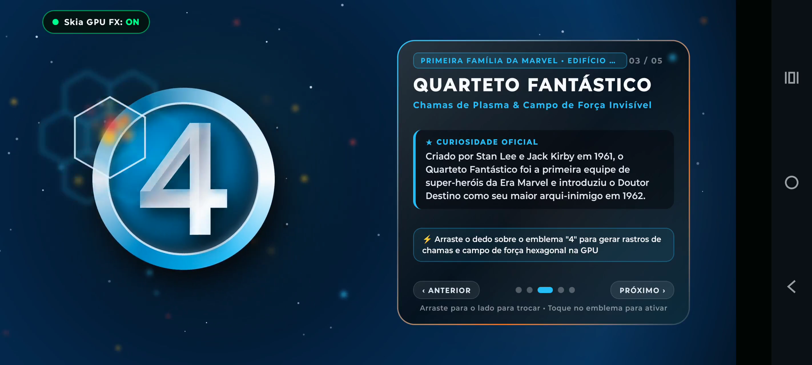
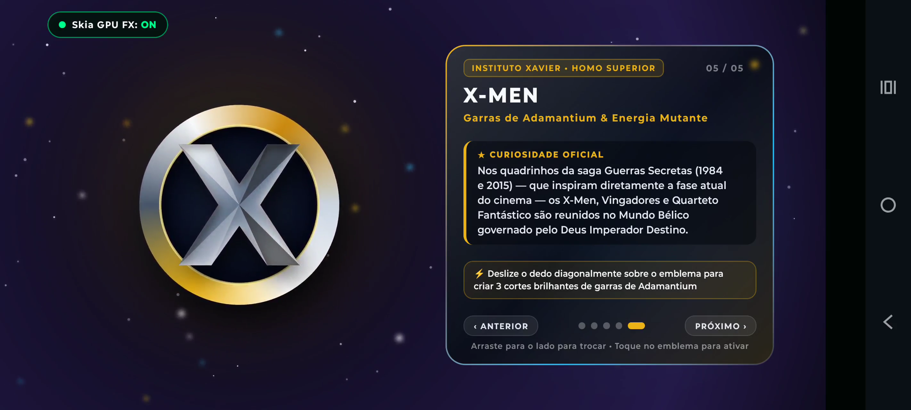

# ⚡ React Native Skia — O Poder da GPU no Mobile

> Projeto prático da apresentação (**Avengers: Doomsday**) usando `@shopify/react-native-skia` + Expo para renderizar gráficos 2D e efeitos visuais direto na GPU.

---

## 🎨 O que é o Skia? (Resumo)

O **Skia** é o motor gráfico 2D usado no Chrome, Android e Flutter. No React Native (`@shopify/react-native-skia`), ele funciona como um **tradutor 2D** dentro de um `<Canvas>`: transforma formas, gradientes, sombras e *shaders* em comandos matemáticos executados direto na **GPU** (Metal no iOS / Vulkan e OpenGL ES no Android).

**Pontos importantes:**
- **60 / 120 FPS reais:** Animações rodam fora da thread de JavaScript (via Reanimated + JSI).
- **Regra 90% + 10%:** Use `<View>` e `StyleSheet` para a UI comum (90%) e Skia apenas onde precisa de GPU (10%).
- **Leve no pacote:** Adiciona só **4 MB a 6 MB** ao app.
- **Ecossistema:** Integra com `reanimated`, `gesture-handler`, `expo-sensors`, `expo-haptics` e `victory-native`.
- **Usado em produção:** Shop (Shopify), Rainbow Wallet, Notesnook, Runna e Rippling.

---

## 🎤 Apresentação — Perguntas e Respostas

### Que problema ela resolve?
A UI padrão (`<View>`, `<Text>`, `<Image>`) **trava na CPU** quando anima muitos elementos ao mesmo tempo e **não tem** recursos nativos como vidro fosco real, sombras internas ou *shaders*. O Skia leva esses desenhos para a GPU sem engasgos.

### Quais os principais recursos?
- **Desenho vetorial (`<Canvas>`, `Path`, `Circle`, `Rect`)** direto na GPU.
- **Gradientes avançados:** `LinearGradient`, `RadialGradient` e `SweepGradient` (reflexo metálico).
- **Efeitos visuais:** `BackdropBlur` (vidro fosco), `BlurMask` (brilho neon) e `Shadow` interna.
- **Shaders (SkSL):** Partículas, efeitos líquidos e iluminação em tempo real.

### Tem alguma limitação?
- **Sem Flexbox:** Posições (`x`, `y`) precisam ser calculadas manualmente dentro do `<Canvas>`.
- **Bloco único:** Formas desenhadas não têm `onPress` nativo nem seleção de texto (exige cálculo de toque manual e cuidado extra com acessibilidade/SEO).
- **Tipografia:** Fontes exigem carregamento explícito (`useFont()`).
- **Não é 3D nem player de vídeo:** Não decodifica MP4/áudio e não faz câmera 3D sozinho (em 3D, fornece texturas 2D para engines como TypeGPU).

### Quais as principais diferenças entre recursos similares?
| Ferramenta | Quando usar | Diferença para o Skia |
| :--- | :--- | :--- |
| **React Native Skia** | Gráficos dinâmicos, *shaders* e efeitos na GPU | Desenho programático em tempo real a 60/120 FPS. |
| **Lottie** | Animações prontas do After Effects (JSON) | Não cria gráficos dinâmicos nem reage com *shaders*. |
| **`react-native-svg`** | Ícones e vetores estáticos | Cria elementos nativos na CPU e engasga com muitos itens animados. |
| **Three.js / TypeGPU** | Cenas 3D com câmera e profundidade | Foco em 3D; o Skia é especialista em 2D. |

---

## 📸 App Prático: Avengers: Doomsday (`Skia GPU FX: ON`)

| Doutor Destino | Quarteto Fantástico | X-Men |
| :---: | :---: | :---: |
|  |  |  |

---

## 🚀 Como rodar a apresentação e o app

- **Apresentação (Slides):** Abra o arquivo [`ApresentacaoSkia/index.html`](ApresentacaoSkia/index.html) diretamente no navegador.
- **App Prático (Expo Go):**
  ```powershell
  cd react-native-skia
  npm install
  npx expo start --tunnel -c
  ```
  Escaneie o QR Code no app **Expo Go** (SDK 58). *(Na mesma rede Wi-Fi, você também pode usar `npx expo start -c`).*
