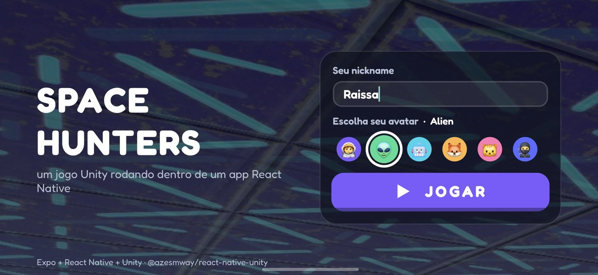
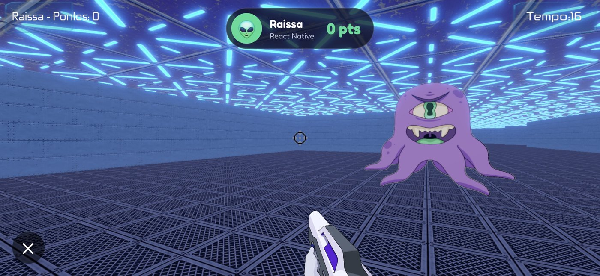
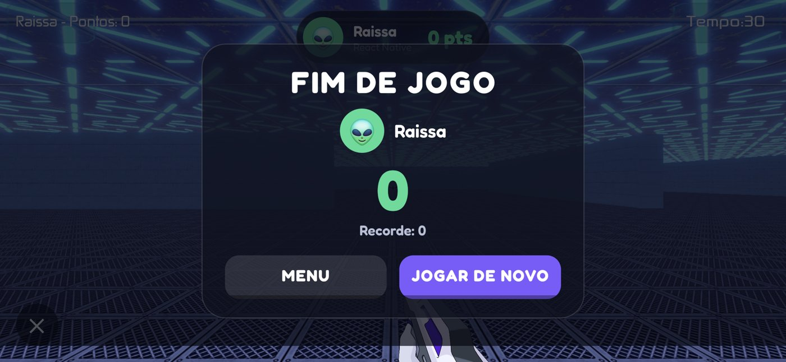

# Space Hunters: Unity dentro do React Native com Expo

Seminário da disciplina de **Desenvolvimento para Dispositivos Móveis** (ADS · IFSP Caraguatatuba · 2026).
Autora: **Raissa Patricio**

Um jogo feito na **Unity** rodando **dentro** de um app **React Native/Expo**, com a biblioteca [`@azesmway/react-native-unity`](https://github.com/azesmway/react-native-unity). O menu, o placar e a tela de fim de jogo são React Native; o jogo é Unity, no mesmo app.

| Menu (React Native) | Jogo (Unity + placar em React) | Fim de jogo (React) |
|---|---|---|
|  |  |  |

**Slides:** [apresentação no Canva](https://canva.link/n25iv4rfzdqky49)

## Resumo da biblioteca

### Que problema ela resolve?
Um app feito em React Native é ótimo para telas comuns, como login, listas, formulários e menus, mas não foi feito para 3D pesado. A Unity é o contrário: é ótima para jogos e 3D, mas é trabalhosa para fazer telas comuns. A `@azesmway/react-native-unity` junta os dois **no mesmo app**. As telas ficam em React Native, o jogo fica na Unity, e os dois trocam informações enquanto o app roda.

Ela usa o recurso oficial da Unity chamado **Unity as a Library**, que exporta o jogo como uma peça para outro app. Também traz um **config plugin para o Expo**, que coloca essa peça no projeto Android sem precisar editar arquivos nativos à mão.

### Quais os principais recursos?
- **Componente `<UnityView />`:** mostra o jogo na tela como se fosse uma `View` qualquer. Dá para colocar elementos React por cima, como o placar e o botão de fechar deste projeto.
- **React → Unity:** `postMessage(objeto, método, valor)` chama um método C# de um objeto da cena.
- **Unity → React:** o evento `onUnityMessage` recebe textos enviados pelo jogo. Aqui, os pontos vão em JSON.
- **Controle do motor:** `pauseUnity`, `resumeUnity` e `unloadUnity`, e os eventos `onPlayerUnload` e `onPlayerQuit`.
- **Config plugin do Expo:** no `expo prebuild`, inclui a `unityLibrary` no Gradle (*Continuous Native Generation*).
- **Android e iOS:** no iOS, usa o `UnityFramework` exportado pelo Xcode. Na versão 1.1.1, tem suporte à Unity 6.

### Tem alguma limitação?
- **Não funciona no Expo Go.** A Unity é código nativo e precisa ser compilada dentro do app, por isso é preciso um **Development Build**.
- **Só uma Unity por app.** O motor da Unity só pode ser ligado uma vez. Ao sair do jogo, ele pausa; ao voltar, retoma.
- **APK grande** (aqui, cerca de 130 MB), porque o motor (`libunity.so`) vai junto.
- **A comunicação é só texto.** Dados mais complexos precisam ser enviados em JSON, e o nome do objeto e do método precisa ser exatamente igual nos dois lados. Se estiver diferente, a mensagem se perde sem dar erro.
- **Arquitetura do processador:** este APK foi gerado só para **ARM64**, então não roda em celulares com sistema de 32 bits, como alguns aparelhos com Android Go. Daria para incluir ARMv7, mas o APK ficaria maior.
- **iOS só compila em Mac,** com Xcode, ou na nuvem, com o EAS Build. Este projeto foi testado só no Android.
- **O jogo precisa ser adaptado:** é preciso criar controles por toque, configurar o export (IL2CPP, ARM64) e escrever um script de ponte (aqui, o `RNBridge.cs`).
- **É uma biblioteca da comunidade,** não da Unity nem do Expo. Atualizações do React Native, do Expo ou da Unity podem depender de novas versões dela.

### Quais as principais diferenças entre recursos similares?

| Opção | Como funciona | Vantagem | Desvantagem |
|---|---|---|---|
| **`@azesmway/react-native-unity`** (usada aqui) | Jogo Unity nativo dentro do app | Desempenho de jogo nativo; tem plugin para Expo; é mantida | APK grande; precisa de Development Build |
| **`react-native-unity-view`** (antiga) | Mesma ideia, de 2018 | Foi a primeira ponte | Abandonada; não suporta as versões novas |
| **WebView + Unity WebGL** | O jogo roda como página web dentro do app | Simples; funciona até no Expo Go | Mais lenta; arquivos pesados para carregar; gasta mais bateria |
| **three.js / React Three Fiber** (`expo-gl`) | 3D escrito em JavaScript | Tudo em React; app leve | Sem o editor e os recursos da Unity; 3D mais simples |
| **App Unity separado** | O jogo é um app à parte | Sem integração para manter | Dois apps, com troca de dados difícil |

**Quando vale a pena:** quando já existe um jogo ou uma cena 3D na Unity e o app precisa de telas comuns, como login, menus e cadastro, trocando dados com o jogo.

## Baixar e jogar

[**⬇ Baixar o APK (Google Drive)**](https://drive.google.com/file/d/1hhid4MLGsJdKa5G9mHUb2ZtS6h0E1L8M/view?usp=sharing) · cerca de 130 MB. Ele roda em celulares Android 8 ou mais novos, de 64 bits (ARM64). Na instalação, o Android pede para permitir "instalar apps desconhecidos".

**Controles:** a metade esquerda da tela é o joystick para andar; arraste na metade direita para mirar e toque rápido para atirar. A partida dura 60 segundos.

## Como funciona

```
Jogo na Unity ──export Android──► unityLibrary ──Gradle──► <UnityView /> na tela React
```

1. A Unity exporta o jogo como **biblioteca Android** (recurso oficial *Unity as a Library*).
2. O `npx expo prebuild` gera a pasta `android/`, e o **config plugin** da biblioteca inclui a `unityLibrary` no Gradle.
3. A biblioteca fornece o componente `<UnityView />`, usado como qualquer outra `View`.
4. App e jogo trocam mensagens:
   - **React → Unity:** `postMessage('RNBridge', 'SetJogador', nome)`;
   - **Unity → React:** o jogo envia `{"tipo":"ponto"}` e o app recebe no `onUnityMessage`.

### Por que precisa de prebuild?
A Unity é **código nativo**, que precisa ser compilado dentro do app. O **Expo Go** já vem compilado e não aceita código nativo novo. Por isso usamos um **Development Build**: o `expo prebuild` gera a pasta `android/` a partir do `app.json` e dos config plugins (*Continuous Native Generation*).

## Tecnologias

| Peça | Versão |
|---|---|
| Expo SDK | 58 (Development Build) |
| React Native | 0.88 |
| Biblioteca | `@azesmway/react-native-unity` 1.1.1 |
| Unity | 6 · IL2CPP · ARM64 |
| Android | minSdk 26 |

## Como rodar

```powershell
npm install
powershell -ExecutionPolicy Bypass -File scripts\exportar-unity.ps1 -UnityProject C:\caminho\do\jogo
npx expo prebuild -p android --clean
npx expo run:android
```

Os scripts do jogo estão em `unity-scripts/`. O projeto completo da Unity e o export não estão no repositório, por causa do tamanho e dos assets de terceiros.

## Estrutura

```
app.json                  nome, orientação e plugins
src/app/                  telas: menu (index.tsx) e jogo (jogo.tsx)
src/components/           componentes do menu e do jogo
src/config/               textos, avatares, imagens e duração da partida
src/unity/JogoUnity.tsx   integração com a Unity
plugins/                  config plugin do Android
unity-scripts/            scripts C# do jogo e da integração (RNBridge.cs + Editor/)
```

## Créditos
- **Código:** Raissa Patricio.
- **Assets do jogo:** gratuitos, de terceiros (também aparecem nos fundos do menu e nos prints).
- **Biblioteca:** [`@azesmway/react-native-unity`](https://github.com/azesmway/react-native-unity) (MIT).
- **Fonte:** [Fredoka](https://fonts.google.com/specimen/Fredoka) (OFL).
- **Licença:** MIT para o código deste repositório; não vale para os assets de terceiros.
